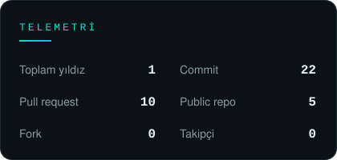
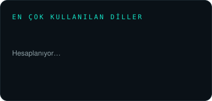

 

<!-- E-posta rozeti istersen aşağıdaki satırı aç ve adresini yaz:

-->

## 🦺 Şu an

- 🛡️ Liman sahası için **İSG yazılımları** geliştiriyorum: risk değerlendirme, eğitim takibi, kaza ve uygunsuzluk kayıtları
- 🌐 Tek dosyalık, hızlı çalışan **web uygulamaları** yapıyorum: HTML, JavaScript, Firebase
- 🤖 **Yapay zekâ** ile iş akışlarını otomatikleştiriyorum: prompt kütüphaneleri, raporlama, içerik üretimi
- 📺 Yan proje: **Lumio IPTV** (Windows ve Android)
- ⚡ Motto: *önce güvenlik, sonra kod.*

## 🚀 Projeler

<table>
<tr>
<td width="50%" valign="top">

**[🦺 assanport-hse-takip](https://github.com/future01software/assanport-hse-takip)** 
Liman İSG takip paneli: saha denetimleri, uygunsuzluklar ve aksiyonlar tek ekranda. 

</td>
<td width="50%" valign="top">

**[🚪 giris-personel](https://github.com/future01software/giris-personel)** 
Personel giriş ve kayıt uygulaması. 

</td>
</tr>
<tr>
<td width="50%" valign="top">

**[🇹🇷 eniyiturkcepromptlar](https://github.com/future01software/eniyiturkcepromptlar)** 
En iyi Türkçe yapay zekâ promptları koleksiyonu. 

</td>
<td width="50%" valign="top">

**[📺 lumio-releases](https://github.com/future01software/lumio-releases)** 
Lumio IPTV kurulum dosyaları (Windows MSI, Android APK). 

</td>
</tr>
<tr>
<td colspan="2" valign="top">

**[✈️ skycopilot-mvp](https://github.com/future01software/skycopilot-mvp)** 
SkyCopilot MVP: erken aşama prototip.

</td>
</tr>
</table>

## 🧰 Cephanelik

## 📊 Telemetri

  

<i>"Güvenli bir saha, iyi yazılmış bir sistemle başlar."</i>

